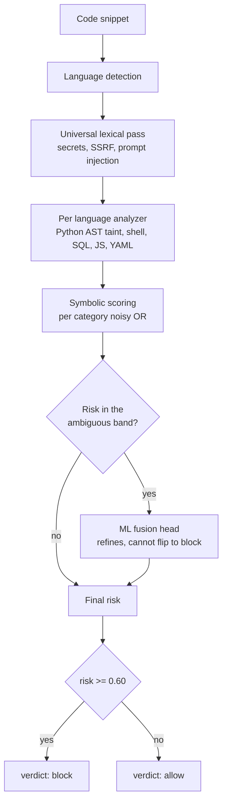
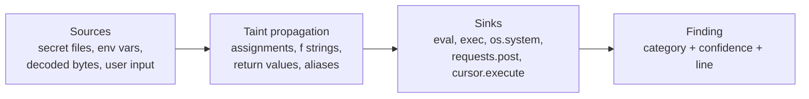

# CodeGuard

CodeGuard is a real time, pre execution safety layer for code produced by AI agents.

Autonomous agents now write and run their own code, shell commands, and SQL. That code can
read credentials, send data to outside servers, delete files, escalate privileges, hide its
intent behind obfuscation, install malicious packages, exhaust machine resources, reach
internal network addresses, or carry text that tries to manipulate a downstream AI reviewer.
Most existing scanners run as batch jobs in CI, and invoking one as a subprocess on every
request is far too slow to sit in front of live execution.

CodeGuard inspects a snippet before it runs and returns an allow or block decision in about
a millisecond. It runs on CPU only and never calls an external language model to reach that
decision.

```http
POST /evaluate      {"code": "..."}

{
  "verdict": "block",
  "risk_score": 0.72,
  "categories": ["data_exfiltration"],
  "code_language": "python",
  "reason": "Blocked (risk 0.72): [data_exfiltration] line 3: ...",
  "vulnerable_lines": [3]
}
```

## How it works

CodeGuard is a symbolic first, neuro symbolic cascade. Cheap deterministic analysis settles
the clear cases, and a trained classifier refines the ambiguous ones.



Detection is based on meaning rather than keywords. The modules `os` and `subprocess` are
not treated as dangerous by themselves. Instead the engine parses the code and follows how
data moves through it. For Python it builds an abstract syntax tree and tracks taint, which
means it watches whether a value that came from a sensitive source reaches a dangerous call.



A constant that reaches a sink is safe, while a tainted value is not. This is why CodeGuard
allows `ast.literal_eval`, parameterised SQL, `crontab -l`, and reading a user config file,
yet blocks the malicious versions that look almost identical. The same engine powers the
HTTP API, the `@guard` decorator used in the interception demo, and a small web interface.

## Detection categories

CodeGuard covers nine categories and a snippet can match more than one at once.

| Category | What it catches |
|----------|-----------------|
| secret_access | reading credentials, keys, or tokens |
| data_exfiltration | sending local data to an outside destination |
| destructive_command | deleting or corrupting data or systems |
| persistence_or_privesc | startup hooks, cron, sudoers, privilege gains |
| obfuscated_execution | decoding and running hidden payloads |
| dependency_risk | typosquatted or malicious package installs |
| resource_exhaustion | fork bombs, infinite loops, huge allocations |
| ssrf_network_exfil | reaching metadata or internal addresses |
| ai_targeted_instructions | text in comments or strings aimed at an AI reader |

An updatable threat intelligence feed in `engine/intel/` generalises the October 2026
LiteLLM supply chain attack, covering Python startup hook persistence, look alike domains,
AI key harvesting, compromised package versions, and typo or slop squatting.

## Machine learning

The machine learning component is trained and wired into the pipeline rather than left as a
placeholder. It is a one vs rest logistic regression model over sixty eight symbolic engine
features joined with three thousand TF IDF character n grams. Training lives in
`engine/ml/train.py` and uses only the synthetic training set, never the dev, validation, or
hold out data. The model is about three hundred kilobytes and needs no deep learning runtime
at inference.

It is enabled by default and runs on cases whose symbolic risk is ambiguous. A guardrail
keeps the symbolic layer in charge of the allow or block decision, so the model can raise
confidence and add corroborating categories on flagged code but can never turn a benign
result into a block. By construction it cannot introduce false positives. Setting
`CODEGUARD_USE_ML=0` forces rules only operation.

Measured honestly, the symbolic rules already reach their ceiling on our test sets, so the
model's effect on the verdict is currently neutral and it contributes calibrated category
probabilities and score refinement. The full ablation is in `eval/efficiency.md`, and we
report only numbers we actually measured.

## Results

The figures below are dataset accuracies, not a claim about real world detection, because
the sets are small and the hidden judging set will differ.

| Dataset | Precision | Recall | F1 | FPR |
|---------|-----------|--------|----|----|
| Dev (42) and synthetic validation (581), used for tuning | 1.00 | 1.00 | 1.00 | 0.00 |
| Independent hold out (30), never tuned on | 0.86 | 0.80 | 0.83 | 0.13 |

The dev and validation scores are optimistic because the engine was tuned against them. The
thirty example hold out was written separately and never used for tuning or training, and it
is our honest estimate of how the engine generalises. Latency is about one millisecond at
the ninety fifth percentile, measured locally and in process.

## Quick start

```bash
python -m venv .venv
source .venv/bin/activate
pip install -r requirements.txt

uvicorn app.main:app --port 8000      # web interface and API at http://127.0.0.1:8000/
python demo/intercept_check.py        # interception proof, exits 0 on success
pytest -q                             # test suite
```

The service exposes `POST /evaluate`, `POST /evaluate/batch`, `GET /health`, and `GET /`.

## Interception proof

Classifying code is not the same as stopping it, so `demo/intercept_check.py` guards real
function calls. The `@guard` decorator runs the engine on a function's source and raises
before the call when the verdict is block. A malicious setup helper that plants a LiteLLM
style startup hook is blocked during static analysis and never runs. An obfuscated variant
that slips past static analysis is caught by a runtime tripwire built on `sys.addaudithook`.
Both are proven by a marker file that is never created, and only this controlled pair is
ever executed. The `/evaluate` endpoint itself never runs the code it receives.

## Repository layout

The engine lives in `engine/`, where `pipeline.py` orchestrates analysis, `analyzers/` holds
the per language logic, `knowledge.py` is the shared security knowledge base, `aggregator.py`
scores findings, and `ml/` holds the fusion head. The FastAPI service and web interface are
in `app/`, the interception guard and demo in `runtime/` and `demo/`, the evaluation harness
and reports in `eval/`, the synthetic data generator in `data/gen/`, and the tests in
`tests/`, where every rule has both a malicious case and a benign twin. Deployment notes are
in `deploy/`, and the architecture write up is in `docs/WRITEUP.md`.

## Design constraints honored

No external language model is used for the verdict. The engine is CPU only. The `/evaluate`
endpoint never executes, imports, or writes the submitted code. Any internal error fails
closed to a valid block rather than a silent allow. Every fixture and test uses fake secrets
and placeholder domains only.

## License and credits

CodeGuard is released under the MIT License, in the `LICENSE` file.

| Component | Role | License |
|-----------|------|---------|
| FastAPI, Starlette, Uvicorn | HTTP service | MIT, BSD 3 |
| Pydantic | request and response validation | MIT |
| scikit learn | machine learning classifier | BSD 3 |
| Python standard library (ast, tokenize, shlex, ipaddress) | static analysis | PSF |

The detection logic, taint tracking, rules, and datasets are the team's own work, and the
threat intelligence indicators come from public incident reports. Parts of the project were
developed with the help of an AI coding assistant, disclosed per the hackathon rules, while
all design decisions, detection logic, and review are the team's own.

## Notes

The organizer dev dataset and the internal challenge and hold out sets are kept local only
and are not committed. Place the dev file in `data/dev/` to run `eval/evaluate.py`. Without
it, the one dataset dependent test is skipped.
