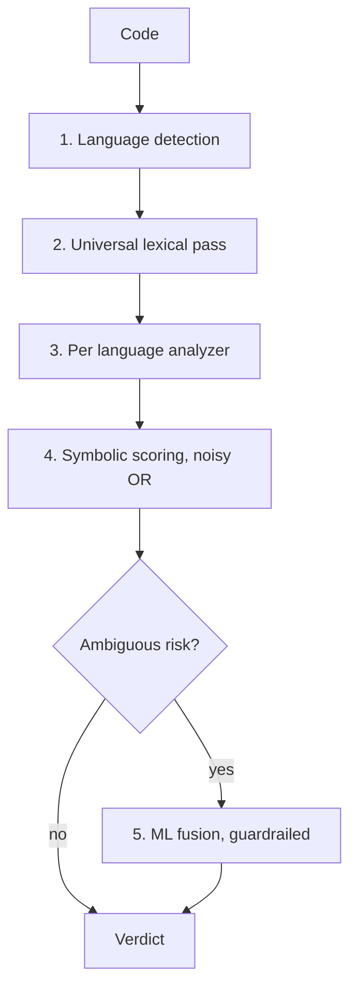

# CodeGuard: Architecture and Design Write up

## Problem

Autonomous AI agents increasingly generate and run their own code, shell commands, and SQL.
That code can read credentials, send data to outside servers, run destructive commands,
escalate privileges, hide its intent behind obfuscation, install malicious packages, exhaust
machine resources, reach internal network endpoints, or embed instructions aimed at a
downstream AI reviewer. Existing scanners run as batch jobs out of band, and calling one as a
subprocess on every request is too slow to sit inline before execution. CodeGuard is a
lightweight layer that inspects a snippet before it runs and returns an allow or block
verdict in about a millisecond, on CPU only, without calling an external language model to
make that decision.

## Approach and key design decisions

The central decision is to analyze meaning rather than match keywords. A keyword list flags
`os`, `subprocess`, or `eval` indiscriminately and quickly drowns in false positives.
CodeGuard parses the code and follows how data moves through it. For Python it builds an
abstract syntax tree and tracks taint, watching whether a value from a sensitive source such
as a secret file, an environment variable, decoded bytes, or user input reaches a dangerous
call such as `eval`, `os.system`, `requests.post`, or a formatted `cursor.execute`. A
constant that reaches such a call is safe, while a tainted value is not. This distinction is
why the engine allows `ast.literal_eval`, parameterised SQL, `crontab -l`, and reading a user
config file, while blocking the malicious versions that look almost identical. Those near
twins are exactly the cases that separate a real analyzer from a regular expression filter.

Analysis is arranged as a cascade that runs cheapest first.



Language detection uses shebangs, parser confirmation, and weighted cues to classify a
snippet as Python, Bash, JavaScript, SQL, YAML, or Markdown. One careful detail is that code
which parses as valid Python but embeds SQL inside a string stays classified as Python, so a
query string is not mistaken for raw SQL. The universal pass then scans the raw text in any
language for hard coded credentials, SSRF and internal addresses, and prompt injection aimed
at an AI reader, which covers comments and strings everywhere. The per language analyzers
follow, with the Python taint analyzer as the main investment, command level rules for Bash,
statement level rules for SQL, and structural rules for JavaScript and YAML or Markdown. Each
finding carries a calibrated confidence, and per category these combine with a noisy OR so
that several weak signals accumulate while one strong signal is enough. The overall risk is
the strongest category, and the verdict is block when risk reaches sixty percent.

For snippets whose symbolic risk is ambiguous, a trained classifier refines the result. It is
a one vs rest logistic regression over sixty eight symbolic engine features joined with three
thousand TF IDF character n grams, trained only on the synthetic training set. It is enabled
by default, and a guardrail keeps the symbolic layer in charge of the allow or block
decision. The model may raise confidence and corroborate categories on already flagged code,
but it cannot turn a benign result into a block, so it cannot add false positives by
construction. We chose logistic regression over a heavy transformer because it is fast on
CPU, interpretable, and honest about what our data supports. A frozen sentence embedding
front end is a documented next step rather than a claimed result.

The service fails closed. The evaluate endpoint never executes, imports, or writes the
submitted code. If a parser fails, the remaining layers still run, and if analysis fails
entirely the response is a valid block. Oversized input is analyzed at both its head and its
tail, so a payload hidden after padding is still seen, and it is flagged. Internal errors
return block rather than a silent allow.

## Interception proof

Classifying code is not the same as stopping it, so the demo guards real function calls. A
`@guard` decorator runs the engine on a function's source and raises before the call when the
verdict is block. A malicious setup helper that plants a LiteLLM style startup hook is blocked
during static analysis and never runs. An obfuscated variant that evades static analysis is
caught by a runtime tripwire built on `sys.addaudithook`. Both are proven by a marker file
that is never created, and only this controlled pair is ever executed.

## Evaluation and honesty

We separate the sets the engine was tuned on from the set it was not.

| Dataset | Precision | Recall | F1 | FPR |
|---------|-----------|--------|----|----|
| Dev (42) and synthetic validation (581), tuned on | 1.00 | 1.00 | 1.00 | 0.00 |
| Independent hold out (30), never tuned on | 0.86 | 0.80 | 0.83 | 0.13 |

The perfect dev and validation scores are optimistic because the engine was tuned against
those sets, and they are not a real world claim. The thirty example hold out was written
independently and never used for tuning or training. It is small, but it is our honest
estimate of how the engine will generalise, and it tells us real world detection will land
below the tuned figures. The machine learning ablation in `eval/efficiency.md` shows rules
and rules plus model producing the same verdicts on every set, because the symbolic rules
already reach their ceiling there, and we present that real table rather than an inflated
one. Latency is about one millisecond at the ninety fifth percentile, measured locally and in
process. Training data comes from a template based generator with no language model, with a
benign twin for every malicious pattern and a split that keeps template families separate
between training and validation, so the model is never evaluated on families it trained on.

## Components, licenses, and disclosure

The service uses FastAPI, Starlette, and Uvicorn under MIT and BSD 3, Pydantic under MIT for
validation, scikit learn under BSD 3 for the classifier, and the Python standard library
under the PSF license for analysis. No external language model is used for the verdict, in
training, or in data generation. The detection logic, taint tracking, rules, and datasets are
the team's own work, and the threat intelligence indicators come from public incident
reports. Development used an AI coding assistant, disclosed per the rules, while all design
decisions and review are the team's own. The project is released under the MIT License.

## Assumptions and known limitations

The Python analyzer is the deepest, while Bash, SQL, JavaScript, and YAML rely on rules and
lighter structural checks, so heavily obfuscated payloads in those languages can slip
through. The model is trained on synthetic data and inherits its distribution, and it does
not yet improve recall over the rules on unseen obfuscation, which is why it runs under a no
false positive guardrail rather than as the decision maker. Posting fields named like
credentials to any external host is treated as exfiltration, so a legitimate login to a first
party API is blocked, which is a deliberate and cautious trade off. Finally, the hold out
figures of roughly eighty six percent precision and eighty percent recall indicate that
detection on the hidden set will sit below the tuned set numbers.

## Running it

```bash
pip install -r requirements.txt
uvicorn app.main:app --port 8000     # API and web interface at http://127.0.0.1:8000/
python demo/intercept_check.py       # interception proof
pytest -q                            # test suite
```

The service exposes `POST /evaluate`, `POST /evaluate/batch`, `GET /health`, and `GET /`.
